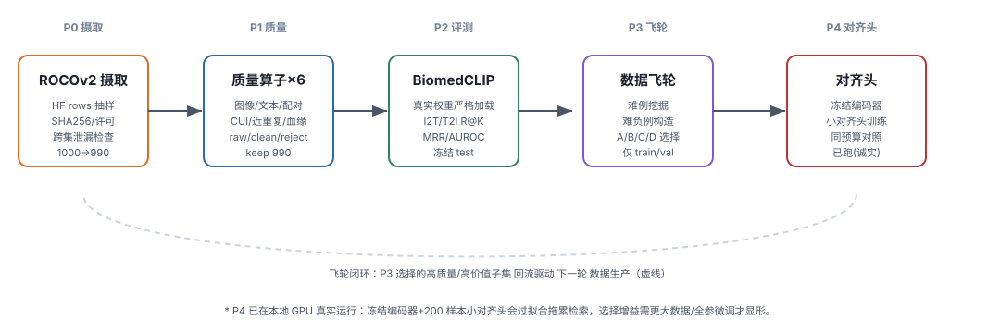

# MedAlignFlywheel

> 医疗多模态数据对齐 · 质量评估 · 高价值数据飞轮
> 求职项目（目标岗位：蚂蚁集团 · 全模态大模型数据—蚂蚁健康）

---

## 1. 这个项目解决什么

多模态大模型（如图文对齐模型）的上限，很大程度取决于**训练数据的质量与结构**。
本项目用公开医学数据集 **ROCOv2** 作为基底，端到端搭建一条可复现的医学多模态数据流水线，
并直面三个真实问题：

1. **合规与泄漏**：公开数据从哪来、许可是什么、train/val/test 之间有没有近重复泄漏；
2. **数据质量**：图像是否损坏、图注是否残缺/重复、CUI 概念是否可用、近重复是否污染；
3. **高价值数据飞轮**：在有限标注预算下，怎么挑出"最值得训"的子集（困难样本 / 长尾概念 / 难负例）。

---

## 2. 关键结果（真实跑出来的，非编造）

### P2 · 跨模态检索评测（真实 BiomedCLIP 权重，冻结 test 集，200 候选）

| 方向 | R@1 | R@5 | R@10 | MRR | AUROC(clean) |
|---|---|---|---|---|---|
| Image→Text（test） | **0.805** | 0.965 | 0.990 | 0.873 | **0.997** |
| Text→Image（test） | **0.810** | 0.975 | 0.990 | 0.879 | — |
| Image→Text（validation） | 0.727 | 0.955 | 0.985 | 0.828 | 0.997 |

- 正例平均相似度 **0.141**，净化后负例平均 **0.107**（二者可分）；共排除 **146** 个"模糊负例"（图注高度重叠或图像近重复），避免 AUROC 被高估。
- **候选规模对照（200/500/1000）**：I2T R@1 = 0.805 / 0.665 / 0.590，AUROC 始终 ≈0.997（指标非"缩小候选"虚高）；test 池仅 2 近重复图像 / 27 近相同图注 / 36 混淆查询，剔除后 R@1=0.811（不降），**同源/重复/相似样本未人为变易任务**。

### P0 · 严格独立测试集（最终权威指标）

> 此前封存的 55 条 holdout 经审计**已被旧实验使用**（14/55 与难例重叠、55/55 出现在难负例候选池），
> 已从 holdout 用途中废弃。最终指标改由 **1000 条从未参与开发的公开 ROCOv2 样本**给出，
> 且与开发集 `sample_id` **零重叠**；配置先冻结（`configs/frozen_final_eval.json`）、**只评价一次**。

| 候选规模 | I2T R@1 | 95% CI | R@5 | R@10 | MRR | T2I R@1 | AUROC |
|---|---|---|---|---|---|---|---|
| 200 | **0.810** | [0.755, 0.860] | 0.970 | 0.995 | 0.883 | 0.810 | 0.9976 |
| 500 | 0.666 | [0.626, 0.708] | 0.924 | 0.972 | 0.782 | 0.656 | 0.9976 |
| 1000 | 0.587 | [0.556, 0.619] | 0.870 | 0.926 | 0.712 | 0.590 | 0.9970 |

**必须同时说明的三条限制**：① ROCOv2 不暴露来源论文 ID，只能按近重复簇分组（本集内易混淆样本 160）；② 图文并非严格一对一，近相同图注在语义上也可能正确，R@1 是保守口径；③ BiomedCLIP 在 PMC-15M 预训练、ROCOv2 来自 PMC OA 子集，**存在预训练数据重叠可能**，高 R@1 不能解读为纯净的零样本泛化能力。
- 权重经严格门禁加载（`strict zero-missing zero-unexpected` + SHA256 指纹），见 `reports/embedding_run.json`。
- **模型保真度（最终审计口径）**：词表与官方 `vocab.txt` **字节级 SHA256 一致**、官方 `tokenizer.json` 词表顺序 **0 处不一致**、特殊 token（[PAD]=0/[UNK]=1/[CLS]=2/[SEP]=3）一致、预处理 mean/std 一致、池化为最后一层 CLS、token_type 经消融验证确实参与前向。但**全塔前向的逐向量等价性仍为 BLOCKED**（本机 open_clip 两种方案均失败），因此**不声称"与官方完全等价"**，只声称"无已知计算差异"，并提供 `scripts/reference_compare_openclip.py` 供一键验证。详见 `reports/model_fidelity_audit.json` 与 `docs/FINAL_AUDIT_REPORT.md`。

### P3 · 数据飞轮

- **难例挖掘**（train+validation）：229 例（risk_false_positive 214、hard_positive 15），全部预留人工复核字段。
- **难负例构造**：4736 候选，1218 个"确定负例"（通过 来源/概念/语义 三重校验）。
- **四种数据选择策略**（train，预算=200）：

| 策略 | 模态覆盖 | CUI覆盖 | 困难样本 | 近重复占比 |
|---|---|---|---|---|
| A 随机 | 8 | 18 | 53 | 2.0% |
| B 质量过滤 | 8 | 18 | 53 | 2.0% |
| C 质量+困难优先 | 8 | 17 | **166** | 4.0% |
| D 质量+长尾优先 | 6 | 15 | 61 | 3.5% |

> 这些只是**数据侧**描述；是否带来模型指标差异必须由 P4 对照训练给出，本项目不在选择阶段下结论。

### P4 · 对齐头对照（冻结编码器 + 小对齐头，同预算 A/B/C/D）

- **已真实运行**（GPU，200 样本/策略，400 步，残差对齐头）。冻结 test 评估：

| 设置 | I2T R@1 | 说明 |
|---|---|---|
| 冻结基线（不训练） | 0.805 | step-0 对齐头 = 恒等映射，等于此基线 |
| A 随机 | 0.578 ± 0.016 | 过拟合拖累 |
| B 质量过滤 | 0.578 ± 0.016 | 与 A 一致（清洁子集质量过滤近乎空操作） |
| C 质量+困难优先 | 0.507 ± 0.018 | 比随机更差 |
| D 质量+长尾优先 | 0.527 ± 0.017 | 比随机更差 |

- 多随机种子（seed 0/1/2）下四策略均稳定低于基线，差异在噪声内。
- **诚实结论**：在已接近天花板的冻结编码器上，仅用 200 样本训练小对齐头会**过拟合并拖累**检索（0.81→0.57）；困难/长尾优先的 C/D 比随机 A/B 更差。这说明：**本规模 + 冻结编码器下，数据选择的增益不可见**，选择效应需全参微调或更大数据才显形。P4 的价值在于给出这一边界结论，而非宣称某种策略更优。详见 `reports/p4_diagnostic.json`。

---

## 3. 流水线结构（P0→P4）



| 阶段 | 内容 | 关键产物 |
|---|---|---|
| **P0** | ROCOv2 合规摄取、SHA256/许可记录、跨集泄漏检查、模型保真度审计、预注册未见 holdout | `data/metadata/p0_provenance.json`、`raw_manifest.jsonl`、`reports/reference_audit.json`、`data/metadata/holdout_seal.json`、`docs/preregistration.md` |
| **P1** | 六大质量算子（图像/文本/配对/CUI/近重复/血缘） | `data/metadata/quality_report.json`、`clean_manifest.jsonl`、`rejected_manifest.jsonl` |
| **P2** | 真实 BiomedCLIP 向量提取 + 跨模态检索评测（含 200/500/1000 候选对照、泄漏分析） | `data/cache/emb_*.npz`、`reports/retrieval_metrics.json`、`reports/scale_eval.json` |
| **P3** | 难例挖掘 / 难负例构造 / A·B·C·D 四种数据选择 / 合成缺陷测试 / 难例分类 / 面试案例库 | `reports/hard_cases.jsonl`、`reports/hard_negatives.jsonl`、`reports/selection_report.json`、`reports/synthetic_quality.json`、`reports/hard_case_taxonomy.json`、`reports/case_gallery.json` |
| **P4** | 冻结编码器 + 小对齐头对照（已真实运行：step-0 恒等验证 / 梯度 / 曲线 / 多种子） | `src/medalign/flywheel/adapter.py`、`reports/p4_diagnostic.json` |

---

## 4. 目录结构

```
MedAlignFlywheel/
├── assets/architecture.svg        # 流水线架构图
├── configs/quality_ops.json       # 质量算子参数
├── data/
│   ├── raw/images/                # 下载的 ROCOv2 子集图像（~990 张）
│   ├── metadata/                  # 清单 / 血缘 / 质量报告 / 选择结果
│   ├── cache/emb_*.npz            # P2 真实向量缓存（不重复推理）
│   └── external/models/biomedclip/# 真实 BiomedCLIP 权重 + 配置 + vocab
├── docs/                          # 数据卡 / 模型卡 / 一页介绍 / 面试题
├── reports/                       # P2/P3 指标 JSON + index.html 演示页
├── src/medalign/                  # 全部源码（common/pipeline/models/eval/flywheel）
└── scripts/                       # 各阶段一键运行脚本
```

---

## 5. 环境与运行

> 推荐 Python 虚拟环境（含 torch 1.13.1+cu116）：`envs/medalign`。
> 自包含 BiomedCLIP 实现不依赖 `open_clip`/`transformers`/`timm`（这些在本机组合下会 segfault）。

```bash
# P0 摄取（公开数据子集，不做完整 18GB 下载）
python scripts/run_p0_ingest.py
python scripts/run_p0_fidelity_audit.py     # P0-1 模型保真度静态审计
python scripts/run_p0_holdout_seal.py        # P0-5 预注册未见数据

# P1 质量算子
python scripts/run_p1_quality.py

# P2 向量提取（GPU）+ 检索评测 + 规模/泄漏分析
python scripts/run_p2_extract_embeddings.py --splits train validation test
python scripts/run_p2_retrieval_eval.py --splits validation test
python scripts/run_p2_scale_eval.py          # 200/500/1000 候选 + 泄漏分析

# P3 数据飞轮 + 数据价值分析 + 面试案例库
python scripts/run_p3_flywheel.py --budget 200
python scripts/run_p2_synthetic_quality.py   # 合成缺陷测试 + A/B 诊断 + 长尾覆盖
python scripts/run_p2_hard_taxonomy.py       # 229 难例分类
python scripts/run_p3_case_gallery.py        # 四类案例缩略图

# P1/P4 对齐头诊断（step-0 恒等 / 梯度 / 曲线 / 多种子）
python scripts/run_p4_diagnostic.py --device cpu

# 生成 HTML 报告 + 自动化测试
python scripts/render_html.py
python tests/run_validation.py               # 15 项全过 → reports/validation_test_log.txt
```

---

## 6. 数据合规与红线

- **来源**：`eltorio/ROCOv2-radiology`（DOI: 10.57967/hf/3489），许可 **CC BY-NC-SA 4.0**，来源图像来自 PMC Open Access Subset。
- **性质**：图注来自开放获取医学论文的图注，**不是**医院真实影像诊断报告；不得改称。
- **不重新分发**：仅本地评估，HTML 演示只引用本地路径与出处，不对外发布整套图像。
- **冻结纪律**：test 集只用于最终评测，不参与 P1 调参、P3 挖掘/选择、P4 训练。
- **不伪造**：相似度全部来自真实前向推理；任何未实际运行的模块一律标注 `NOT_TESTED`。

---

## 7. 完整性更正记录（公开可追溯）

1. 初版检索出现 **AUROC<0.5、R@1 异常偏低**，根因有二，均已修正：
   - 自包含 `ViTBlock` 前向的预归一化顺序写错 → 改为标准 `x = x + mlp(norm2(x))`；
   - `auroc_rank_based` 计数方向反了（统计成 `neg>pos`）→ 改为统计 `neg<pos`。
   修正后指标恢复至本文档第 2 节真实水平，证明评测链路可信。
2. 近重复聚类曾因传递闭包链式放大产生 **71 条假跨集泄漏**，已改为"星型聚类 + 成员须与 leader 直接满足相似阈值"，假泄漏降为 **0**；最终仅剔除 10 条真实不合格样本（6 图注过短 + 4 近重复图像）。
3. P4 初版 R@1=0.005（≈随机之下），根因是"近恒等初始化"错写成**输出层零初始化**（前向恒为 0，破坏原有对齐）；修正为残差结构 `out = x + mlp(x)`、零初始化即精确恒等后，R@1 回到 0.57——这才是真实值（过拟合拖累），而非 bug。该结论是诚实边界，非"选择提升"。
4. 完整缺陷与修复登记见 `docs/RESULTS_AND_FIXES.md` 第 2 节。

---

## 8. 文档导航

- **最终技术审计报告（模型保真度 / 独立 Holdout / 飞轮价值 / 能力边界）：`docs/FINAL_AUDIT_REPORT.md`**
- **可独立打开的单文件演示包：`demo_package/index.html`**（图片 base64 内嵌，双击离线打开）
- 实验结果表 + 缺陷修复 + 复现命令 + 数据授权 + 边界区分：`docs/RESULTS_AND_FIXES.md`
- 数据卡：`docs/data_card.md`
- 模型卡：`docs/model_card.md`
- 预注册协议：`docs/preregistration.md`
- 一页中文介绍（含简历描述）：`docs/one_pager.md`
- 面试题与答案（34 题）：`docs/interview_qa.md`
- 交互式报告页（含真实图像案例）：`reports/index.html`
